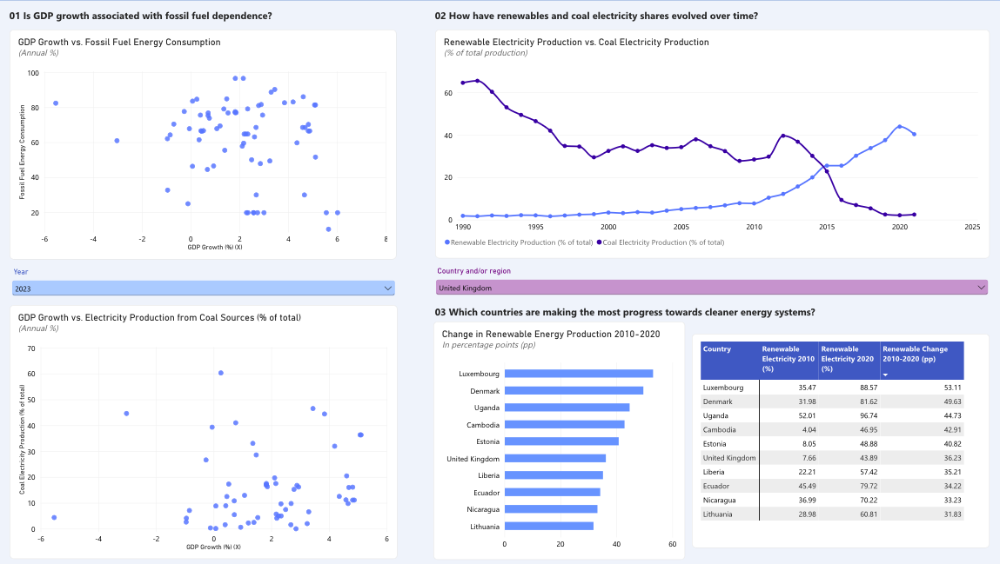
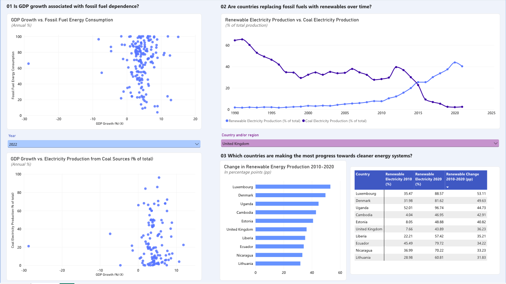
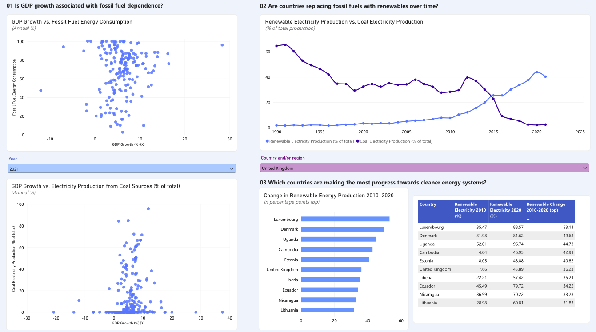
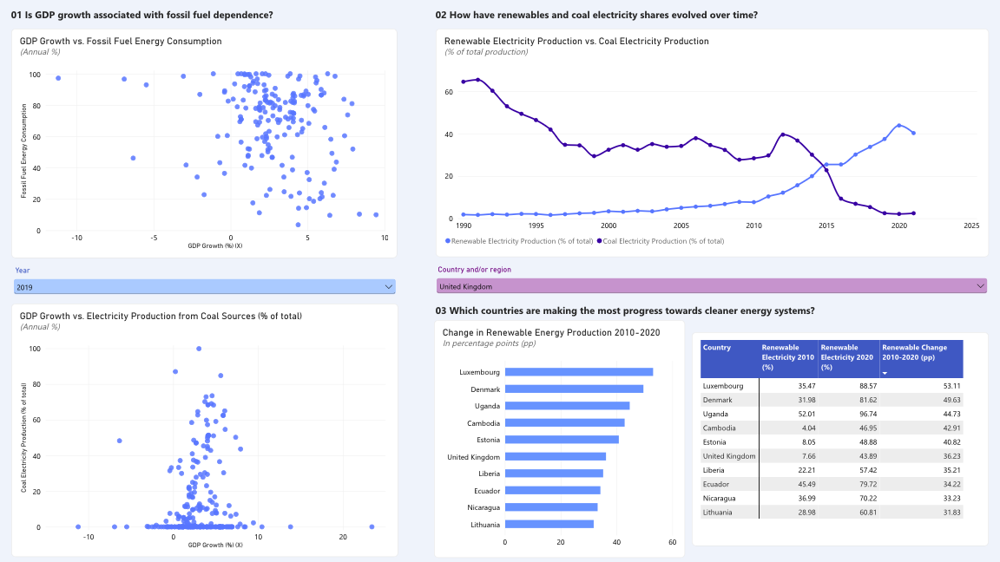
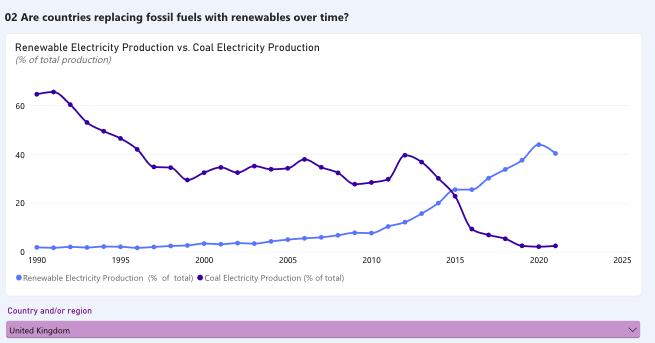
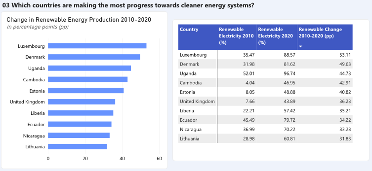

# Sovereign Environmental and Energy Transition Power BI Dashboard

An interactive Power BI report examining the relationship between economic growth and fossil fuel dependence, and the pace of renewable electricity adoption, across economies worldwide, using the World Bank Data360 ESG dataset.

- Tools: Power BI Service (web), DAX, slicers, matrix and chart visuals
- Data: [World Bank Data360, Environment, Social and Governance (WB_ESG)](https://data360.worldbank.org/en/dataset/WB_ESG)
- Scope: the environmental ("E") indicators only

## Motivation

My professional background includes researching and assessing climate and environmental risks and carrying out ESG due diligence. That work sits at the intersection of finance and sustainability, and I wanted to keep developing those skills on my own terms by working directly with a large, real dataset and testing specific questions against it. This repository is the result: a report built end to end in Power BI, with the calculations, checks and limitations documented so that each figure can be traced and reproduced.

I chose sovereign-level environmental indicators because energy systems differ sharply between economies that grow at similar rates, and because country-level energy mix is a standard input to sovereign ESG assessment. The report addresses three questions:

1. Is annual GDP growth associated with a country's reliance on fossil fuels, or on coal for electricity?
2. How have the renewable and coal shares of electricity generation evolved over time? The United Kingdom is used as the worked example, and the report includes a dropdown for any other economy.
3. Which economies increased their renewable share of electricity generation the most between 2010 and 2020?

The analysis is descriptive. It is not a sovereign ESG rating, and it makes no causal claim about climate policy. Throughout, I keep three types of quantity separate: levels (percentage shares), economic growth (an annual percentage change), and transition progress (changes in percentage points).

The full report is included as a Power BI file, [Sovereign Environmental and Energy Transition Power BI Dashboard.pbix](Sovereign%20Environmental%20and%20Energy%20Transition%20Power%20BI%20Dashboard.pbix), which can be opened in Power BI Desktop to inspect the data model, DAX measures and visuals. The calculations and checks are documented in [docs/METHODOLOGY.md](docs/METHODOLOGY.md). No public report URL has been published.

## Data Overview

The source is the WB_ESG export from World Bank Data360, downloaded in November 2026. The data are in long format: one row is one observation, defined by a geographic area, an indicator, a year and a value. The original export, `WB_ESG.csv` (about 160 MB), is kept in the local `data/` folder and is excluded from version control because it exceeds GitHub's 100 MB file limit. It can be downloaded again from the World Bank link in the Source section.

| Item | Value in the downloaded CSV |
|---|---:|
| Observations (rows) | 461,719 |
| Distinct indicators | 71 |
| Distinct geographic codes | 239 |
| Codes that are ISO 3166-1 alpha-3 countries, economies or territories | 193 |
| Other codes (regions, income groups, other aggregates) | 46 |
| Years present anywhere in the file | 1960 to 2023 |

The figure of 239 does not denote 239 sovereign states. The file combines individual economies with aggregates such as Arab World, OECD members, the European Union and the World Bank income groups. Filtering on ISO codes leaves 193 entities, a small number of which are territories. Coverage for any given indicator and year is smaller still.

The report uses the following indicators:

| Indicator | Code | Unit |
|---|---|---|
| GDP growth | `WB_ESG_NY_GDP_MKTP_KD_ZG` | annual % (not per capita) |
| Fossil fuel energy consumption | `WB_ESG_EG_USE_COMM_FO_ZS` | % of total energy consumption |
| Electricity production from coal | `WB_ESG_EG_ELC_COAL_ZS` | % of total electricity output |
| Electricity production from renewables | `WB_ESG_EG_ELC_RNEW_ZS` | % of total electricity output |

Fossil fuel use is measured against total energy consumption, whereas the coal and renewable figures are measured against electricity generation. The denominators differ, so the measures are never combined.

## Exploratory Data Analysis (EDA)

Before building the visuals I reviewed the availability of each indicator, which varies by year. The most recent years are the thinnest: renewable electricity output ends in 2021, renewable final energy consumption in 2022, and the coal and fossil fuel series extend to 2023 with far fewer reporting areas.

For the scatter plots, I joined GDP growth to each energy indicator on `REF_AREA` and `TIME_PERIOD` in the CSV. I did not drop the non-ISO aggregates for the scatter plots. Regional groupings such as the OECD members remain in the plots alongside individual economies because I found it informative to see where these groups sit relative to the countries that compose them. Each point is therefore a geographic area, which may be either a single economy or an aggregate.

### Key findings

#### 1. Economies with similar GDP growth differ widely in energy mix

The upper scatter plot places GDP growth on the x-axis and the fossil fuel share of energy consumption on the y-axis. The lower plot uses coal's share of electricity generation. Each point is a geographic area with both values available in the selected year. A point at (4, 80) denotes 4% GDP growth and 80% of energy consumption from fossil fuels. It does not mean that fossil fuel consumption grew by 80%.

Across the years captured, areas with comparable growth rates sit at very different fossil fuel and coal shares, and the plots show no clear pattern linking the two:

- 2019 serves as a pre-pandemic baseline.
- 2021 was a rebound year following the pandemic and should not be treated as an ordinary benchmark.
- 2022 has noticeably fewer points in the coal plot than 2021, which limits comparability between the two years.
- 2023 has the fewest points of any year captured. The sparser charts reflect limited coverage and do not indicate that economies have become more alike.

| 2023 | 2022 |
|:---:|:---:|
|  |  |
| 2021 | 2019 |
|  |  |

The scatter plots show association only, not causation, and the set of areas plotted changes from year to year. The x-axis is annual GDP growth, not income, so these charts cannot be used to compare richer and poorer economies. That would require GDP per capita.

#### 2. The United Kingdom replaced coal with renewables over the decade

The line chart has a country/region dropdown and is configured not to respond to the year selector, so it always displays the full history. The United Kingdom is selected as the example.

| United Kingdom, share of electricity output | 2010 | 2020 | Difference |
|---|---:|---:|---:|
| Renewable electricity | 7.66% | 43.89% | +36.23 pp |
| Coal electricity | 28.40% | 2.10% | -26.30 pp |

In 1990 the dataset records approximately 1.82% renewable and 64.56% coal. UK renewable observations end in 2021 (40.31%), while coal observations continue to 2023 (1.57%). The missing renewable values for 2022 and 2023 are left blank in the chart and are not shown as zero. The two series do not sum to 100% because gas, nuclear and other sources are not plotted, and the chart cannot show that coal was displaced one for one by renewables. That would require absolute generation, imports and demand.

#### 3. Luxembourg and Denmark recorded the largest gains in renewable share

The bar chart and matrix rank the change in renewables' share of total electricity output between 2010 and 2020, in percentage points. Only ISO-coded economies with observations in both years are included, which gives 182 economies in this CSV. The ranking measures change in share, not capacity added or overall environmental performance.

| Rank | Country | 2010 | 2020 | Change (pp) |
|---:|---|---:|---:|---:|
| 1 | Luxembourg | 35.47% | 88.57% | +53.11 |
| 2 | Denmark | 31.98% | 81.62% | +49.63 |
| 3 | Uganda | 52.01% | 96.74% | +44.73 |
| 4 | Cambodia | 4.04% | 46.95% | +42.91 |
| 5 | Estonia | 8.05% | 48.88% | +40.82 |
| 6 | United Kingdom | 7.66% | 43.89% | +36.23 |
| 7 | Liberia | 22.21% | 57.42% | +35.21 |
| 8 | Ecuador | 45.49% | 79.72% | +34.22 |
| 9 | Nicaragua | 36.99% | 70.22% | +33.23 |
| 10 | Lithuania | 28.98% | 60.81% | +31.83 |

Cambodia is notable for the scale of its improvement from a low base of 4.04% in 2010. Uganda's 96.74% share in 2020 describes the composition of electricity generated and says nothing about the proportion of the population with reliable access to electricity. The United Kingdom ranks sixth by gain in share, which is a narrower claim than ranking sixth for overall sustainability.

The 2020 endpoint was affected by COVID-19, which altered demand and the generation mix. A natural robustness test is to repeat the ranking for 2010 to 2019 and 2010 to 2021 and examine whether the order holds. I have not yet carried out this test.

## Method

The data remain in long format, with area, indicator, year and `OBS_VALUE` held in separate columns. DAX measures select values by exact indicator code and preserve the country and year context. The ranking measure is the 2020 renewable share minus the 2010 share, expressed in percentage points rather than relative growth.

- Two scatter plots complemented by a year dropdown, which allows any single year from 1960 to 2023 to be selected.
- A renewable versus coal line chart driven by a country/region slicer.
- A top-10 bar chart and a matrix showing 2010, 2020 and the difference, independent of both slicers.
- Explicit year filters for 2010 and 2020. Percentages are never summed across indicators or countries.

Formulas and the indicator mapping are documented in [docs/METHODOLOGY.md](docs/METHODOLOGY.md). To inspect the report, open the `.pbix` file in Power BI Desktop. To rebuild it from scratch, download the WB_ESG dataset from the link above and follow that document.

## Limitations

- The CSV contains 46 aggregates that are not countries, and the scatter plots retain them. A strictly country-level analysis would need to exclude them, and ISO-code filtering is a practical check for that, not a legal definition of statehood.
- Sample size and composition change from year to year, so a sparser scatter plot does not by itself indicate an economic change.
- Shares are not absolute generation or installed capacity.
- The report covers the environmental pillar only. A fuller sovereign ESG assessment would also require governance and social outcomes.
- No result here is causal.

## Source

World Bank, *Environment, Social and Governance (WB_ESG)*, [World Bank Data360](https://data360.worldbank.org/en/dataset/WB_ESG), downloaded November 2026 as `WB_ESG.csv`, the file used for all figures in this report (stored locally at `data/WB_ESG.csv`, not committed because of its size). The charts, calculations and interpretations are my own and are not endorsed by the World Bank. The World Bank generally publishes open data under [CC BY 4.0](https://datacatalog.worldbank.org/public-licenses), subject to dataset and third-party indicator terms. See also the [World Bank Sovereign ESG framework](https://esgdata.worldbank.org/data/framework).

## Annex

Screenshots of the report from the `assets/` folder, provided for further context. Figures A1 to A3 show the scatter plots with a different year selected; A4 and A5 show the other two report sections.

**Figure A1.** Full dashboard, 2022 selected.

**Figure A2.** Full dashboard, 2021 selected.

**Figure A3.** Full dashboard, 2019 selected.

**Figure A4.** United Kingdom renewable and coal electricity shares over time.

**Figure A5.** Top ten increases in renewable electricity share, 2010 to 2020.

Source: World Bank Data360 (WB_ESG), downloaded November 2026.
